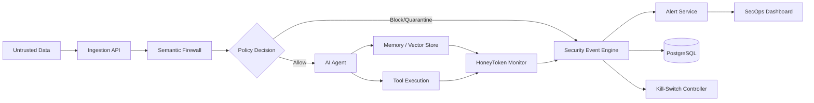

# 02 — Technical Architecture Document

## 1. Architecture Overview
Use a **modular monolith** for the MVP.

Recommended stack:
- Frontend: React + TypeScript
- Backend: Python + FastAPI
- Database: PostgreSQL
- Vector storage: pgvector initially; Qdrant can be introduced when independent vector scaling is justified
- AI detection: Python service layer with pluggable embeddings/classifier/LLM providers
- Real-time updates: WebSocket or Server-Sent Events
- Containers: Docker
- API: REST
- Background jobs: simple application worker initially; Redis only when asynchronous workload requires it

## 2. High-Level Architecture



## 3. Main Components
### Ingestion Layer
Receives text and normalized content from supported sources.

### Semantic Firewall
Runs normalization, rule checks, semantic classification, risk scoring, and policy evaluation.

### Agent Adapter
A controlled integration point between AgentSentry and an AI agent.

### HoneyToken Manager
Creates, registers, and monitors synthetic decoy values.

### Security Event Engine
Converts detections into normalized events with severity, evidence, agent ID, timestamp, and action.

### Alert Service
Pushes events to the dashboard.

### Kill-Switch Controller
Changes an agent's operational status to isolated and prevents new controlled actions.

### SecOps Dashboard
Consumes REST APIs and real-time events.

## 4. Detection Pipeline
1. Normalize input.
2. Run cheap deterministic checks.
3. Run semantic detection.
4. Calculate risk score.
5. Apply policy.
6. Log decision.
7. Continue or quarantine.

## 5. Example Risk Model
```text
risk = weighted(rule_score, semantic_score, source_trust, attack_indicators)
```

Use a normalized 0–100 score.

Suggested initial policy:
- 0–29: allow
- 30–69: review/quarantine depending on source and policy
- 70–100: block

These thresholds must be configurable and treated as initial defaults, not universal security truth.

## 6. Core Data Model
### agents
- id
- name
- status
- risk_score
- created_at
- updated_at

### security_events
- id
- agent_id
- event_type
- severity
- source
- risk_score
- evidence
- action
- created_at

### alerts
- id
- event_id
- status
- acknowledged_by
- acknowledged_at

### honeytokens
- id
- token_identifier
- agent_id
- location
- status
- triggered_at

### policies
- id
- name
- enabled
- thresholds
- actions
- created_at

### audit_logs
- id
- actor_id
- action
- target
- metadata
- created_at

## 7. API Surface
Example endpoints:
```text
POST   /api/v1/ingest
POST   /api/v1/analyze
GET    /api/v1/agents
GET    /api/v1/agents/{id}
POST   /api/v1/agents/{id}/isolate
POST   /api/v1/agents/{id}/restore
GET    /api/v1/events
GET    /api/v1/alerts
POST   /api/v1/alerts/{id}/acknowledge
GET    /api/v1/honeytokens
GET    /api/v1/audit-logs
GET    /api/v1/policies
POST   /api/v1/policies
```

## 8. Integration Points
The hardest integration points are:
- Intercepting agent context without breaking framework semantics.
- Preserving provenance of untrusted content.
- Preventing tool execution after a block/isolation decision.
- Monitoring vector-store access without leaking sensitive content.
- Keeping detection latency low enough for interactive agents.

## 9. Deployment
### MVP
One Docker Compose environment:
- FastAPI
- React frontend
- PostgreSQL
- Optional pgvector

### Production direction
Separate API, detection workers, event processing, and data services only when measured load justifies it.

## 10. Failure Handling
- Detector timeout → fail closed for high-risk sources, otherwise apply configured fallback.
- Database outage → do not silently discard critical security events; use bounded local buffering.
- Dashboard outage → security decisions continue independently.
- LLM provider outage → deterministic/rule-based fallback.
- Duplicate events → idempotency/event IDs.

## 11. Architecture Risks
- Overusing LLM calls can create latency and cost.
- Semantic detection can be evaded.
- Central middleware can become a single point of failure.
- Excessive logging can expose sensitive content.

## 12. Assumptions
The MVP uses a modular monolith and synthetic attack data. Security decisions are made before controlled agent/tool execution.
