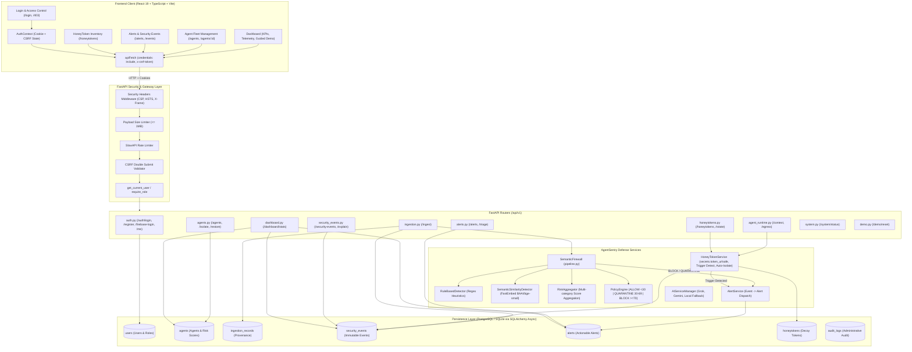
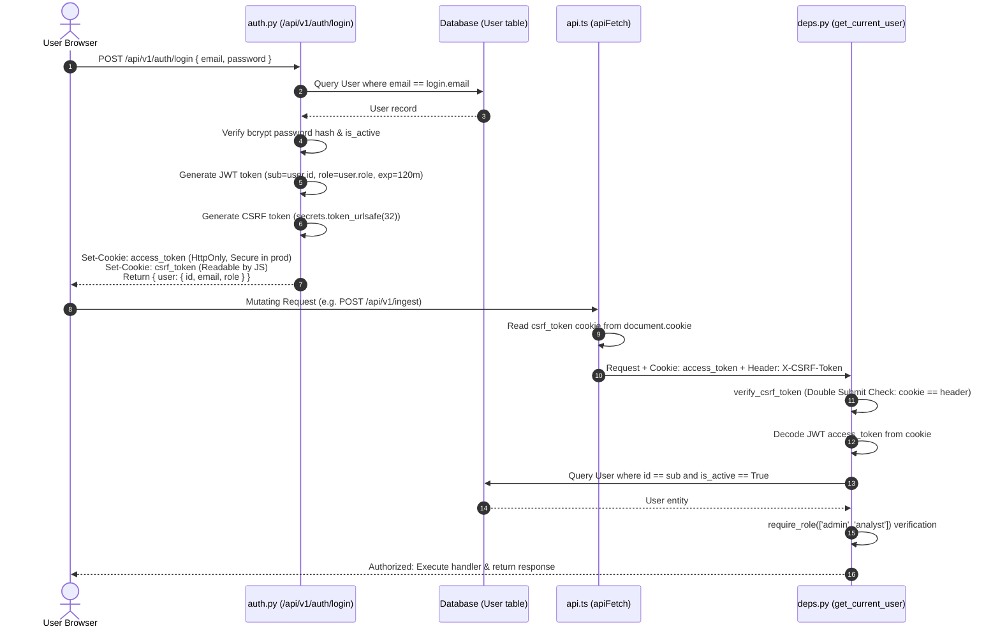

# AgentSentry — AI Agent Architecture & Context Guide (`AGY.md`)

> **Persistent Knowledge Base & Architectural Blueprint for AI Agents**  
> *Generated & Verified against Codebase on 2026-10-08*  
> *Refer to [`graphify-out/GRAPH_REPORT.md`](file:///F:/All%20projects%20here/project/AgentSentry/graphify-out/GRAPH_REPORT.md) and [`graphify-out/graph.json`](file:///F:/All%20projects%20here/project/AgentSentry/graphify-out/graph.json) for code graph navigation.*

---

## 1. Overview

### What AgentSentry Is
**AgentSentry** is an open-source security framework designed to protect autonomous AI agents from **indirect prompt injection**, **data exfiltration**, and **unauthorized actions**. It acts as a security middleware and monitoring layer positioned between untrusted external data sources and autonomous agent runtimes.

### Problem It Solves
AI agents frequently process unstructured external content—such as inbound emails, scraped web pages, third-party database records, and webhook payloads. Malicious actors embed indirect prompt injections into these untrusted inputs to:
1. Hijack the agent's instructions and system prompt (`instruction_override`).
2. Force the agent into unauthorized personas (`role_manipulation`).
3. Extract proprietary system instructions and developer prompts (`prompt_extraction`).
4. Read confidential memory and exfiltrate secrets to external servers (`data_exfiltration`).
5. Execute dangerous tool operations and file modifications (`dangerous_action`).

### Intended Users
* **AI/ML Engineers & Agent Developers**: Integrating security controls and decoy tripwires into agent pipelines.
* **Application Security (AppSec) Engineers**: Auditing agent security postures and enforcing egress policies.
* **SOC & SecOps Analysts**: Monitoring security events, reviewing alerts, and managing agent isolation.
* **Evaluators & Technical Teams**: Reviewing hackathon and enterprise MVP implementations.

### Main Purpose
Provide a lightweight defense-in-depth security loop that:
1. **Pre-execution**: Evaluates untrusted content using a dual-engine Semantic Firewall before data reaches the agent.
2. **Execution Context**: Plants cryptographically secure decoy data (**HoneyTokens**) inside the agent's context.
3. **Post-execution / Runtime**: Intercepts outbound egress traffic to detect data breaches, instantly logging immutable security events, raising alerts, and triggering automated agent isolation (kill-switch).

### Major Features
* **Dual-Engine Semantic Firewall**: Fast rule-based heuristic regex inspection combined with local embedding-based semantic similarity scoring using FastEmbed.
* **Deterministic Risk Aggregator & Policy Engine**: Computes aggregated risk scores (0–100) across attack categories and assigns enforcement decisions (`ALLOW`, `QUARANTINE`, `BLOCK`).
* **HoneyToken Mesh**: Generates cryptographically secure decoy credentials, injects them into agent runtime contexts, tracks trigger metrics, and supports rotation.
* **Egress Enforcement Gateway**: Scans outbound agent communications for HoneyToken exfiltration and enforces automatic agent isolation.
* **Security Event Engine & Alerts**: Immutable audit logs capturing risk scores, evidence snippets, policy actions, and automatic triage into high/critical alerts.
* **Fleet Management & Kill-Switch**: Agent registration, health status tracking, manual or automatic isolation, and restoration.
* **Interactive SecOps Dashboard & Guided Demo**: Dark cybersecurity UI with real-time KPI metrics, event logs, alert feeds, and an end-to-end interactive attack simulator.
* **Secure Session Authentication & RBAC**: Double-Submit Cookie CSRF protection, HttpOnly JWT cookies, and role-based permissions (`admin`, `analyst`, `viewer`).

---

## 2. Tech Stack

| Layer | Technology | Version | Purpose |
| :--- | :--- | :--- | :--- |
| **Frontend Framework** | [React](https://react.dev/) | `19.2.8` | Client-side UI component library |
| **Frontend Language** | [TypeScript](https://www.typescriptlang.org/) | `~6.0.2` | Type-safe JavaScript application code |
| **Frontend Bundler** | [Vite](https://vitejs.dev/) | `8.2.1` (`^8.2.0`) | Fast frontend development server and production bundler |
| **Client Routing** | [React Router DOM](https://reactrouter.com/) | `7.18.4` (`^7.18.4`) | Client-side routing and protected navigation |
| **Animation / Icons** | [Framer Motion](https://www.framer.com/motion/) / [Lucide React](https://lucide.dev/) | `13.4.1` / `1.47.0` | Micro-interactions, transitions, and cybersecurity iconography |
| **3D Visualization** | [@splinetool/runtime](https://spline.design/) | `2.0.55` | 3D interactive graphics for hero/landing areas |
| **Frontend Linter** | [Oxlint](https://oxc.rs/) | `1.75.0` | High-performance linter for TypeScript/React |
| **Backend Framework** | [FastAPI](https://fastapi.tiangolo.com/) | `0.110.0` | High-performance asynchronous REST API backend |
| **ASGI Web Server** | [Uvicorn](https://www.uvicorn.org/) | `0.27.1` | ASGI web server implementation |
| **Data Validation** | [Pydantic](https://docs.pydantic.dev/) | `2.6.4` | Request/response data models and schema validation |
| **ORM / Data Access** | [SQLAlchemy](https://www.sqlalchemy.org/) | `2.0.52` (`>=2.0.0`) | Asynchronous ORM and SQL abstraction |
| **PostgreSQL Driver** | [asyncpg](https://github.com/MagicStack/asyncpg) | `0.31.0` | Asynchronous PostgreSQL database client |
| **SQLite Driver** | [aiosqlite](https://github.com/omnilib/aiosqlite) | `0.22.1` | Asynchronous SQLite driver for local dev & automated tests |
| **Database Migrations**| [Alembic](https://alembic.sqlalchemy.org/) | `1.19.1` | Schema version control and database migrations |
| **Semantic Embedding** | [FastEmbed](https://github.com/qdrant/fastembed) | `0.3.6` | Lightweight local embedding inference (`BAAI/bge-small-en-v1.5`) |
| **Vector Runtime** | [ONNX Runtime](https://onnxruntime.ai/) | `1.30.0` | High-performance CPU execution for embedding models |
| **Numerical Math** | [NumPy](https://numpy.org/) | `1.26.4` | Vector math and cosine similarity calculations |
| **Auth / Cryptography**| [PyJWT](https://pyjwt.readthedocs.io/) | `2.8.0` | JWT access token creation and verification |
| **Password Hashing** | [bcrypt](https://pypi.org/project/bcrypt/) / [passlib](https://passlib.readthedocs.io/) | `5.0.0` / `1.7.4` | Salted bcrypt credential hashing |
| **API Rate Limiting** | [SlowAPI](https://slowapi.readthedocs.io/) | `0.1.9` | In-memory IP rate limiting middleware |
| **Backend Testing** | [pytest](https://pytest.org/) / [pytest-asyncio](https://github.com/pytest-dev/pytest-asyncio) | `9.1.1` / `1.4.0` | Asynchronous test framework |
| **HTTP Test Client** | [HTTPX](https://www.python-httpx.org/) | `0.28.1` | Async HTTP client for integration test suite |
| **Dev Runner** | Node.js ESM script (`scripts/dev.mjs`) | Node 18+ | Orchestrated dual-server development runner with health checks |
| **Deployment / CI** | Render (`render.yaml`), Docker (`docker-compose.yml`) | Compose 3.8 | Multi-container configuration and cloud deployment |
| **Code Graph Context** | [Graphify](https://github.com/safishamsi/graphify) (`graphifyy`) | `0.9.80` | Tree-sitter AST knowledge graph generator & assistant skill |

---

## 3. Architecture



---

## 4. Frontend

### Entry Point
* [`frontend/src/main.tsx`](file:///F:/All%20projects%20here/project/AgentSentry/frontend/src/main.tsx): Mounts the React application into `#root` inside `StrictMode`.
* [`frontend/src/App.tsx`](file:///F:/All%20projects%20here/project/AgentSentry/frontend/src/App.tsx): Configures client-side routing via `BrowserRouter`, wraps routes in `ToastProvider` and `AuthProvider`.

### Routes
| Route | Component | Access | Description |
| :--- | :--- | :--- | :--- |
| `/login` | [`Login.tsx`](file:///F:/All%20projects%20here/project/AgentSentry/frontend/src/pages/Login.tsx) | Public | User credentials login form |
| `/403` | [`AccessDenied.tsx`](file:///F:/All%20projects%20here/project/AgentSentry/frontend/src/pages/AccessDenied.tsx) | Public | Access denied / RBAC forbidden landing page |
| `/` | `Navigate to="/dashboard"` | Protected | Root redirection to main dashboard |
| `/dashboard` | [`Dashboard.tsx`](file:///F:/All%20projects%20here/project/AgentSentry/frontend/src/pages/Dashboard.tsx) | Protected | SecOps dashboard, metrics cards, and guided demo |
| `/agents` | [`Agents.tsx`](file:///F:/All%20projects%20here/project/AgentSentry/frontend/src/pages/Agents.tsx) | Protected | Fleet overview, search, and agent registration modal |
| `/agents/:id` | [`AgentDetails.tsx`](file:///F:/All%20projects%20here/project/AgentSentry/frontend/src/pages/AgentDetails.tsx) | Protected | Deep dive into an individual agent: status, kill-switch, telemetry |
| `/alerts` | [`Alerts.tsx`](file:///F:/All%20projects%20here/project/AgentSentry/frontend/src/pages/Alerts.tsx) | Protected | Actionable alert list, status filters, and severity tags |
| `/events` | [`Events.tsx`](file:///F:/All%20projects%20here/project/AgentSentry/frontend/src/pages/Events.tsx) | Protected | Immutable security event stream with evidence inspection |
| `/honeytokens` | [`HoneyTokens.tsx`](file:///F:/All%20projects%20here/project/AgentSentry/frontend/src/pages/HoneyTokens.tsx) | Protected | Decoy token inventory, trigger statistics, and rotation |
| `*` | [`NotFound.tsx`](file:///F:/All%20projects%20here/project/AgentSentry/frontend/src/pages/NotFound.tsx) | Public | 404 error page |

### Major Components & Responsibilities
* [`AppShell.tsx`](file:///F:/All%20projects%20here/project/AgentSentry/frontend/src/components/AppShell.tsx): Application layout scaffolding providing navigation bar, sidebar, and content container.
* [`Sidebar.tsx`](file:///F:/All%20projects%20here/project/AgentSentry/frontend/src/components/Sidebar.tsx): Left navigation bar featuring active route highlighting and quick links.
* [`TopNav.tsx`](file:///F:/All%20projects%20here/project/AgentSentry/frontend/src/components/TopNav.tsx): Top header showing system operational status, active user email/role badge, and logout trigger.
* [`ProtectedRoute.tsx`](file:///F:/All%20projects%20here/project/AgentSentry/frontend/src/components/ProtectedRoute.tsx): Route guard checking authentication state. Redirects unauthenticated sessions to `/login`.
* [`GuidedDemo.tsx`](file:///F:/All%20projects%20here/project/AgentSentry/frontend/src/components/GuidedDemo.tsx): 6-step interactive security demo running the complete defense loop:
  1. Register demo agent (`DEMO - Research Agent`).
  2. Ingest safe content (`ALLOW`).
  3. Ingest malicious prompt injection (`BLOCK`).
  4. Generate decoy HoneyToken.
  5. Attempt HoneyToken exfiltration via egress gateway (`TRIGGER`).
  6. Verify automated agent isolation and SecOps alert generation.
* [`SpotlightCard.tsx`](file:///F:/All%20projects%20here/project/AgentSentry/frontend/src/components/SpotlightCard.tsx): Cybersecurity SaaS card component featuring dynamic radial hover glow effects.
* [`Badge.tsx`](file:///F:/All%20projects%20here/project/AgentSentry/frontend/src/components/Badge.tsx): Status indicator pill for decisions (`ALLOW`, `QUARANTINE`, `BLOCK`), severities (`CRITICAL`, `HIGH`, `MEDIUM`, `LOW`), and agent states (`active`, `isolated`).
* [`Modal.tsx`](file:///F:/All%20projects%20here/project/AgentSentry/frontend/src/components/Modal.tsx): Accessible dialog overlay for creating new agents.
* [`SkeletonLoader.tsx`](file:///F:/All%20projects%20here/project/AgentSentry/frontend/src/components/SkeletonLoader.tsx): Shimmer state placeholder for asynchronous data fetching.

### State Management & Contexts
* [`AuthContext.tsx`](file:///F:/All%20projects%20here/project/AgentSentry/frontend/src/contexts/AuthContext.tsx): Manages user identity (`User: { id, email, role }`), authentication loading state, and exposes `useAuth()`, `login()`, `logout()`, `checkAuth()`.
* [`ToastContext.tsx`](file:///F:/All%20projects%20here/project/AgentSentry/frontend/src/contexts/ToastContext.tsx): Provides global notification toast banners across pages.

### API Communication Layer
* [`api.ts`](file:///F:/All%20projects%20here/project/AgentSentry/frontend/src/services/api.ts): Central HTTP fetch client:
  - Supports automatic switching between relative path in Vite dev mode (using proxy) and `VITE_API_BASE_URL` in production.
  - Automatically attaches `credentials: 'include'` for HttpOnly cookies.
  - Automatically reads the `csrf_token` cookie and injects `X-CSRF-Token` on non-idempotent HTTP methods (`POST`, `PUT`, `DELETE`, `PATCH`).
  - Intercepts HTTP 401 (redirects to `/login`) and HTTP 403 (redirects to `/403`).

### Frontend Folder Structure
```text
frontend/
├── src/
│   ├── assets/              # Icons, static images (hero.png, react.svg)
│   ├── components/          # Reusable UI widgets (AppShell, GuidedDemo, Modal, SpotlightCard)
│   ├── contexts/            # React contexts (AuthContext, ToastContext)
│   ├── pages/               # Routed view components (Dashboard, Agents, Alerts, Events, etc.)
│   ├── services/            # Backend API communication client (api.ts)
│   ├── App.tsx              # Router configuration and global providers
│   ├── index.css            # Global Tailwind & cyber design system styling
│   └── main.tsx             # Application mount point
├── package.json             # NPM dependencies and scripts
├── tsconfig.json            # TypeScript configuration
└── vite.config.ts           # Vite development server and proxy configuration
```

---

## 5. Backend

### Entry Point & Middleware
* [`backend/main.py`](file:///F:/All%20projects%20here/project/AgentSentry/backend/main.py): Initializes the FastAPI instance (`AgentSentry API`, version `0.1.0`), mounts CORS, security middlewares, rate limiting handlers, and includes all sub-routers.
* **Security Headers Middleware**: Enforces `X-Content-Type-Options: nosniff`, `X-Frame-Options: DENY`, `Strict-Transport-Security` in production, and a Content-Security-Policy permitting the configured frontend origin and Spline runtime assets.
* **Request Size Middleware**: Enforces a strict 1 MB (`1 * 1024 * 1024` bytes) limit on incoming request payloads, returning HTTP 413 if exceeded.
* **Rate Limiter**: Configured via `SlowAPI` with in-memory tracking per remote IP address.
* **Global Error Handler**: Catches all unhandled exceptions, logs traceback via standard logging, and returns safe HTTP 500 JSON without exposing stack traces.

### API Endpoint Registry

| Method | Endpoint | Controller / Handler | Authentication / RBAC | Purpose |
| :--- | :--- | :--- | :--- | :--- |
| `GET` | `/health` | `main.py::health_check` | None (Public) | Liveness & health probe |
| `POST` | `/api/v1/auth/login` | `auth.py::login` | None (Rate limit: 5/min) | Authenticate user, issue HttpOnly JWT & CSRF cookies |
| `POST` | `/api/v1/auth/logout` | `auth.py::logout` | `get_current_user` | Clear authentication and CSRF cookies |
| `GET` | `/api/v1/auth/me` | `auth.py::read_users_me` | `get_current_user` | Fetch currently authenticated user profile |
| `GET` | `/api/v1/agents` | `agents.py::list_agents` | `get_current_user` | List agents (Admins see all; others see owned agents) |
| `POST` | `/api/v1/agents` | `agents.py::register_agent` | Role: `admin`, `analyst` | Register a new AI agent |
| `GET` | `/api/v1/agents/{agent_id}` | `agents.py::get_agent` | `get_current_user` + Ownership | Fetch detailed metadata for a specific agent |
| `POST` | `/api/v1/agents/{agent_id}/isolate` | `agents.py::isolate_agent` | Role: `admin`, `analyst` + Ownership | Manually trigger agent kill-switch / isolation |
| `POST` | `/api/v1/agents/{agent_id}/restore` | `agents.py::restore_agent` | Role: `admin`, `analyst` + Ownership | Restore an isolated agent to active status |
| `GET` | `/api/v1/agents/{agent_id}/context`| `agent_runtime.py::get_agent_context`| Role: `admin`, `analyst` (Rate limit: 100/min)| Retrieve agent system context with injected HoneyTokens |
| `POST` | `/api/v1/agents/{agent_id}/egress` | `agent_runtime.py::egress_enforcement_gateway`| Role: `admin`, `analyst` (Rate limit: 100/min)| Scan outbound agent egress for HoneyToken leaks |
| `POST` | `/api/v1/ingest` | `ingestion.py::ingest_content` | Role: `admin`, `analyst` (Rate limit: 200/min)| Ingest untrusted data through the Semantic Firewall |
| `GET` | `/api/v1/honeytokens` | `honeytokens.py::list_honeytokens` | Role: `admin`, `analyst` | List all decoy HoneyTokens (values redacted) |
| `POST` | `/api/v1/honeytokens` | `honeytokens.py::create_honeytoken` | Role: `admin` | Generate and attach a new HoneyToken to an agent |
| `POST` | `/api/v1/honeytokens/rotate` | `honeytokens.py::rotate_honeytoken` | Role: `admin` | Revoke active HoneyToken and issue a new replacement |
| `GET` | `/api/v1/dashboard/stats` | `dashboard.py::get_dashboard_stats` | `get_current_user` | Aggregate dashboard statistics (agents, alerts, events) |
| `GET` | `/api/v1/alerts` | `alerts.py::list_alerts` | `get_current_user` | Query actionable security alerts |
| `GET` | `/api/v1/security-events` | `security_events.py::list_security_events` | `get_current_user` | Query immutable audit security events |
| `POST` | `/api/v1/demo/reset` | `demo.py::reset_demo` | Role: `admin`, `analyst` | Clean up guided demo agents and associated test events |

### Backend Services & Modules
* [`pipeline.py` (`SemanticFirewall`)](file:///F:/All%20projects%20here/project/AgentSentry/backend/services/firewall/pipeline.py): Orchestrates content analysis across registered detectors, aggregates scores, and applies policy evaluation.
* [`detectors.py` (`RuleBasedDetector`)](file:///F:/All%20projects%20here/project/AgentSentry/backend/services/firewall/detectors.py): Analyzes normalized text against 6 threat categories: instruction override, role manipulation, prompt extraction, data exfiltration, dangerous action, and instruction smuggling. Applies multi-category score boosting.
* [`semantic_detector.py` (`SemanticSimilarityDetector`)](file:///F:/All%20projects%20here/project/AgentSentry/backend/services/firewall/semantic_detector.py): Calculates cosine similarity against embedded anchor vectors using `BAAI/bge-small-en-v1.5` via FastEmbed.
* [`aggregator.py` (`RiskAggregator`)](file:///F:/All%20projects%20here/project/AgentSentry/backend/services/firewall/aggregator.py): Merges detector outputs deterministically, prevents double-counting within categories, and applies multi-detector confidence boosts.
* [`policy.py` (`PolicyEngine`)](file:///F:/All%20projects%20here/project/AgentSentry/backend/services/firewall/policy.py): Maps risk scores to decisions:
  - `0–29`: `ALLOW`
  - `30–69`: `QUARANTINE`
  - `70–100`: `BLOCK`
* [`honeytoken_service.py` (`HoneyTokenService`)](file:///F:/All%20projects%20here/project/AgentSentry/backend/services/honeytoken_service.py): Creates cryptographically secure tokens (`tok_<32_random_bytes>`), scans payloads for tokens, triggers critical security events, and isolates breached agents.
* [`alert_service.py` (`AlertService`)](file:///F:/All%20projects%20here/project/AgentSentry/backend/services/alert_service.py): Generates actionable alerts from high-risk security events while preventing duplicate alerts.

---

## 6. Database

### Database Architecture & Connection
* **Technology**: PostgreSQL (production) or SQLite (local / testing).
* **Connection Setup** ([`backend/database.py`](file:///F:/All%20projects%20here/project/AgentSentry/backend/database.py)):
  - SQLAlchemy asynchronous engine initialized via `create_async_engine(DATABASE_URL)`.
  - Automatic protocol normalization (`postgresql://` → `postgresql+asyncpg://`).
  - Session factory using `async_sessionmaker(engine, class_=AsyncSession, expire_on_commit=False)`.
  - FastAPI dependency `get_db()` yields an async session per request.

### Models & Schema Specifications

| Model | Table Name | Important Fields | Relationships | Purpose |
| :--- | :--- | :--- | :--- | :--- |
| **`User`** | `users` | `id` (UUID, PK)<br>`email` (String 255, Unique, Indexed)<br>`password_hash` (String 255)<br>`role` (String 50: `admin`, `analyst`, `viewer`)<br>`is_active` (Boolean)<br>`created_at`, `updated_at` (DateTime TZ) | Foreign key target for `agents.owner_id` and `audit_logs.user_id` | User accounts, credentials, and RBAC roles |
| **`Agent`** | `agents` | `id` (UUID, PK)<br>`owner_id` (UUID, FK `users.id`, Nullable, Indexed)<br>`name` (String 100)<br>`status` (String 50: `active`, `isolated`)<br>`risk_score` (Integer, 0–100)<br>`created_at`, `updated_at` (DateTime TZ) | Belongs to `User`; referenced by `SecurityEvent`, `Alert`, `HoneyToken`, `IngestionRecord` | Managed AI agent instances and security states |
| **`SecurityEvent`** | `security_events` | `id` (UUID, PK)<br>`agent_id` (UUID, FK `agents.id`, Indexed)<br>`event_type` (String 50)<br>`severity` (String 20: `critical`, `high`, `medium`, `low`)<br>`source` (String 100)<br>`risk_score` (Integer)<br>`evidence` (JSON)<br>`action` (String 50: `ALLOW`, `QUARANTINE`, `BLOCK`, `BLOCK_AND_ISOLATE`)<br>`created_at` (DateTime TZ) | Belongs to `Agent`; referenced uniquely by `Alert` | Immutable security audit trail of all detected anomalies |
| **`Alert`** | `alerts` | `id` (UUID, PK)<br>`security_event_id` (UUID, FK `security_events.id`, Unique, Indexed)<br>`agent_id` (UUID, FK `agents.id`, Indexed)<br>`severity` (String 20)<br>`status` (String 20: `open`, `resolved`, `ignored`)<br>`created_at` (DateTime TZ) | References `SecurityEvent` (1:1) and `Agent` | Actionable notifications requiring analyst attention |
| **`HoneyToken`** | `honeytokens` | `id` (UUID, PK)<br>`agent_id` (UUID, FK `agents.id`, Indexed)<br>`value` (String 255, Unique, Indexed)<br>`scope` (String 50: e.g. `system_prompt`)<br>`token_type` (String 50: `api_key`, `email`)<br>`status` (String 50: `active`, `revoked`)<br>`is_triggered` (Boolean)<br>`trigger_count` (Integer)<br>`last_triggered_at` (DateTime TZ)<br>`created_at` (DateTime TZ) | Belongs to `Agent` | Decoy credentials planted in agent context to detect exfiltration |
| **`IngestionRecord`**| `ingestion_records` | `id` (UUID, PK)<br>`agent_id` (UUID, FK `agents.id`, Indexed)<br>`source_type` (String 50)<br>`provenance` (JSON)<br>`created_at` (DateTime TZ) | Belongs to `Agent` | Records metadata and provenance of untrusted external content |
| **`AuditLog`** | `audit_logs` | `id` (UUID, PK)<br>`user_id` (UUID, FK `users.id`, Nullable, Indexed)<br>`action` (String 255)<br>`target_resource` (String 255)<br>`status` (String 50: `success`, `failed`)<br>`ip_address` (String 50)<br>`created_at` (DateTime TZ) | References `User` | Tracks sensitive administrative operations |

---

## 7. Authentication Flow

AgentSentry implements an authentication mechanism with Double Submit Cookie CSRF protection and role-based authorization:



### Detailed Flow Steps
1. **User Authentication Starts**: The user inputs their email and password into [`Login.tsx`](file:///F:/All%20projects%20here/project/AgentSentry/frontend/src/pages/Login.tsx).
2. **Credentials Processed**: Request hits `POST /api/v1/auth/login` (rate-limited to 5 requests/minute).
3. **Verification**: Backend queries the `users` table, verifies the password hash using `bcrypt.checkpw`, and ensures `is_active` is true.
4. **Token Generation**:
   - Creates a signed JWT access token containing `sub` (User UUID) and `role`, expiring in 120 minutes.
   - Generates a cryptographically random CSRF token via `secrets.token_urlsafe(32)`.
   - Attaches `access_token` cookie with `httponly=True`, `path="/"`, `samesite="lax"` (or `"none"` in production), and `secure=is_production`.
   - Attaches `csrf_token` cookie with `httponly=False` so client JavaScript can read it.
5. **Client Stores & Maintains State**:
   - [`AuthContext.tsx`](file:///F:/All%20projects%20here/project/AgentSentry/frontend/src/contexts/AuthContext.tsx) stores the current user state in React memory.
   - On page load, `checkAuth()` calls `GET /api/v1/auth/me` to validate session freshness.
6. **Request Authentication**:
   - For all mutating HTTP calls (`POST`, `PUT`, `DELETE`, `PATCH`), [`api.ts`](file:///F:/All%20projects%20here/project/AgentSentry/frontend/src/services/api.ts) reads `csrf_token` from `document.cookie` and sets the `X-CSRF-Token` header.
   - Browser automatically includes the HttpOnly `access_token` cookie via `credentials: 'include'`.
7. **Middleware & Route Protection**:
   - `verify_csrf_token()` compares the `csrf_token` cookie with the `X-CSRF-Token` header using `secrets.compare_digest`.
   - `get_current_user` extracts `access_token` cookie, decodes JWT, and verifies the user exists and remains active.
8. **RBAC & IDOR Enforcement**:
   - `require_role(["admin"])` or `require_role(["admin", "analyst"])` enforces role permissions.
   - `verify_agent_ownership(agent, user)` prevents Insecure Direct Object References (IDOR): Non-admin users can only view or manage agents they own.

---

## 8. Environment Variables

> [!CAUTION]
> **Zero Secrets Policy**: Never commit actual secrets, API tokens, or production database passwords.

| Variable Name | Required | Default / Example Value | Purpose |
| :--- | :--- | :--- | :--- |
| `API_PORT` | No | `8000` | Local port on which the FastAPI server listens |
| `ENVIRONMENT` | No | `development` | Environment mode (`development`, `production`). When `production`, enforces strict JWT key length and secure cookies |
| `JWT_SECRET_KEY` | Yes (in prod) | *Set in .env* | Secret key used to sign and verify HMAC-SHA256 JWT access tokens |
| `ALLOWED_ORIGINS` | No | `http://localhost:5173,http://127.0.0.1:5173` | Comma-separated list of allowed CORS origin URLs |
| `DATABASE_URL` | Yes | `sqlite+aiosqlite:///dev.db` | SQLAlchemy connection string (SQLite for dev, PostgreSQL for production) |
| `POSTGRES_USER` | Docker only | `postgres` | PostgreSQL username for Docker Compose container |
| `POSTGRES_PASSWORD`| Docker only | *Set in .env* | PostgreSQL password for Docker Compose container |
| `POSTGRES_DB` | Docker only | `agentsentry` | PostgreSQL database name for Docker Compose container |
| `VITE_API_BASE_URL`| No | `http://localhost:8000` | Target backend URL for production Vite frontend builds |
| `ADMIN_EMAIL` | Optional (seed) | `admin@agentsentry.local` | Email for default admin user when executing `seed_admin.py` |
| `ADMIN_PASSWORD` | Optional (seed) | `adminpassword` | Password for default admin user when executing `seed_admin.py` |
| `ANALYST_EMAIL` | Optional (seed) | `analyst@agentsentry.local` | Email for default analyst user when executing `seed_admin.py` |
| `ANALYST_PASSWORD` | Optional (seed) | `analystpassword` | Password for default analyst user when executing `seed_admin.py` |

---

## 9. Setup and Run

### Prerequisites
* **Python**: 3.12+
* **Node.js**: 18+ and `npm`

### 1. Installation
```powershell
# Clone repository and enter directory
cd AgentSentry

# Python virtual environment setup
python -m venv .venv
.\.venv\Scripts\Activate.ps1
python -m pip install -r backend/requirements.txt

# Frontend dependencies
cd frontend
npm install
cd ..
```

### 2. Environment Configuration
```powershell
# Copy template configuration
Copy-Item .env.example .env
```

### 3. Database Initialization & Seeding
```powershell
# Run database migrations
python -m alembic upgrade head

# Seed default administrator and analyst users
python backend/seed_admin.py
```

### 4. Running the Development Environment
```powershell
# Option A: Orchestrated startup (runs backend on :8000 and frontend on :5173 with health checks)
npm run dev

# Option B: Run backend and frontend separately
# Terminal 1 - Backend:
python -m uvicorn backend.main:app --reload --host 127.0.0.1 --port 8000

# Terminal 2 - Frontend:
npm run dev --prefix frontend
```

### 5. Running Tests & Linters
```powershell
# Run backend test suite (79 passed tests across 12 test suites)
python -m pytest backend/tests/ -v

# Run frontend production build
npm run build --prefix frontend

# Run frontend linter
npm run lint --prefix frontend
```

---

## 10. Coding Conventions

* **Project Structure**: Modular separation between `backend/` (FastAPI, SQLAlchemy, services) and `frontend/` (React, TypeScript, Vite).
* **Python Conventions**:
  - Follows PEP 8 formatting with type annotations on function arguments and return types.
  - Asynchronous first: all database queries use `AsyncSession`, `await db.execute(...)`, and `scalars().all()`.
  - Pydantic v2 schemas used for API boundary validation; SQLAlchemy 2.0 declarative models used for persistence.
  - Defensive error handling: Custom HTTP exceptions with explicit status codes.
  - Zero raw secrets logged: passwords and HoneyTokens are redacted (`REDACTED_TOKEN_VALUE`) in logs and API outputs.
* **TypeScript & React Conventions**:
  - Functional components with React 19 hooks.
  - Strict TypeScript types for all API payloads and entity interfaces.
  - Component co-location under `src/components/` and page views under `src/pages/`.
  - Fast-refresh compatible exports (`export default Component`).
* **Security & Defensive Design**:
  - Double submit CSRF protection on all non-safe methods.
  - IDOR protection: `verify_agent_ownership` checks ensure analysts only interact with their assigned agents.
  - Input truncation: Semantic and regex detectors limit inputs to 50k characters to prevent ReDoS and memory exhaustion.

---

## 11. Notes for AI Agents

> [!IMPORTANT]
> **Guidelines for Future AI Sessions**:
> 1. **Consult the Graph First**: Before exploring or modifying the codebase, run `graphify query "<question>"` or inspect [`graphify-out/GRAPH_REPORT.md`](file:///F:/All%20projects%20here/project/AgentSentry/graphify-out/GRAPH_REPORT.md).
> 2. **Interactive Visualizations**: Open [`graphify-out/graph.html`](file:///F:/All%20projects%20here/project/AgentSentry/graphify-out/graph.html), [`graphify-out/GRAPH_TREE.html`](file:///F:/All%20projects%20here/project/AgentSentry/graphify-out/GRAPH_TREE.html), and [`graphify-out/AgentSentry-callflow.html`](file:///F:/All%20projects%20here/project/AgentSentry/graphify-out/AgentSentry-callflow.html) in a browser to review call hierarchies and community clusters.
> 3. **Verify Everything**: Real functionality only. Never fabricate mock metrics, fake threat counts, or simulated detectors.
> 4. **No Unnecessary Rewrites**: Do not refactor existing working services, routers, or schemas without a direct requirement.
> 5. **Keep Graph Current**: After modifying code files, run `graphify update .` to update the AST graph and maintain community cohesion.
> 6. **Zero Secrets in Code**: Never commit passwords, tokens, or private credentials into documentation or code repositories.
