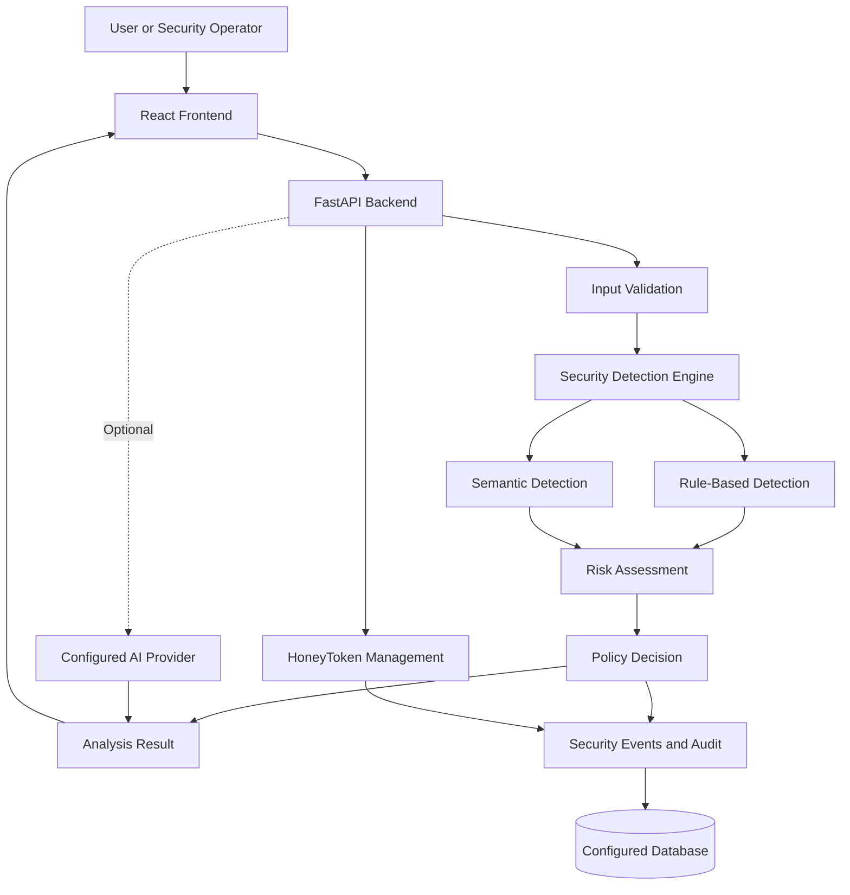

# AgentSentry 🛡️

**AI Security Testing, Prompt Injection Detection & Agent Protection**

AgentSentry is an AI security platform designed to help developers identify suspicious prompts, evaluate potential prompt-injection attacks, monitor security events, and detect unauthorized access using HoneyTokens.

It combines rule-based detection, semantic analysis, risk scoring, policy decisions, and security auditing to make AI security testing easier to understand and investigate.

> **Project goal:** Make AI security testing understandable, accessible, and useful for developers, students, and security teams.

---

## Table of Contents

* [Overview](#overview)
* [The Problem](#the-problem)
* [How AgentSentry Works](#how-agentsentry-works)
* [Key Features](#key-features)
* [Security Engine](#security-engine)
* [System Architecture](#system-architecture)
* [Application Pages](#application-pages)
* [Technology Stack](#technology-stack)
* [Project Structure](#project-structure)
* [Getting Started](#getting-started)
* [Environment Configuration](#environment-configuration)
* [Running the Application](#running-the-application)
* [API Reference](#api-reference)
* [Testing](#testing)
* [Security Considerations](#security-considerations)
* [Limitations](#limitations)
* [Deployment](#deployment)
* [Contributing](#contributing)
* [License](#license)

---

## Overview

AI applications can be manipulated through malicious instructions hidden in prompts, documents, or other external content. These attacks can cause an AI system to ignore intended instructions, reveal information, or attempt unauthorized actions.

AgentSentry provides a security workflow for examining suspicious inputs and reviewing the resulting evidence.

Its main components include:

* **Security Detection Engine:** Examines input using configured detection mechanisms.
* **Risk Assessment:** Combines detection evidence to assess potential risk.
* **Policy Decisions:** Applies security rules to determine the appropriate outcome.
* **HoneyTokens:** Uses decoy values to help identify unauthorized access or disclosure.
* **Security Monitoring:** Records security events and provides investigation tools.
* **AI-Assisted Analysis:** Supports additional analysis through configured AI providers where available.

AgentSentry is intended to support security testing and investigation. It does not guarantee that every malicious prompt or attack will be detected.

## The Problem

AI systems increasingly interact with documents, APIs, databases, external tools, and automated workflows.

This creates several security challenges:

* **Prompt injection:** Malicious instructions attempt to manipulate an AI system.
* **Sensitive information exposure:** An AI workflow may reveal information it should not disclose.
* **Unauthorized tool usage:** An agent may attempt actions outside its intended permissions.
* **Insufficient visibility:** Developers may struggle to understand why a prompt was flagged or blocked.
* **Limited auditing:** Security teams need records of suspicious activity to investigate incidents.

Traditional input validation alone cannot identify every attack because malicious instructions may be expressed in many different ways.

## How AgentSentry Works

The general security workflow is:

1. **Submit input:** A user submits a prompt or content for security analysis.
2. **Validate and normalize:** The application checks and prepares the input for analysis.
3. **Detect suspicious patterns:** Configured security rules and other available detection mechanisms examine the content.
4. **Assess risk:** Detection evidence contributes to a risk assessment.
5. **Apply policy:** The security engine determines the configured action, such as allowing, flagging, quarantining, or blocking the input.
6. **Record the outcome:** Relevant security events can be stored for review and auditing.
7. **Review the result:** Users inspect the verdict, evidence, risk information, and recommended next steps.

The exact stages and available outcomes depend on the configured security pipeline.

## Key Features

### 1. Prompt Security Testing

* Submit custom prompts for analysis.
* Test predefined example scenarios where available.
* Examine suspicious instruction patterns.
* Review risk assessments and detection evidence.
* Understand why a result was produced.

### 2. Rule-Based Detection

Deterministic security rules check for known suspicious patterns and instruction structures. This provides a local analysis mechanism that does not inherently require an external generative AI API.

Rule-based detection is useful for known patterns, but attackers may change wording or use techniques that the rules do not recognize.

### 3. Semantic Analysis

Where configured, semantic analysis can compare input content with representative patterns using vector embeddings.

Semantic similarity can help identify related content that does not use exactly the same words. However, an embedding similarity score is not, by itself, proof that a prompt is malicious.

### 4. Risk Assessment and Policy Decisions

AgentSentry can combine detection results into a risk assessment and apply configured security policies.

The resulting status should be interpreted alongside the supporting evidence. A low score does not guarantee that an input is safe.

### 5. HoneyTokens

HoneyTokens are decoy values intended to help detect unauthorized access or disclosure.

Depending on the implemented configuration, users can manage tokens, review their status, and investigate related events.

Raw HoneyToken values should not be exposed in the user interface, logs, or error messages.

### 6. Security Events and Alerts

* Review recorded security events.
* Inspect event details and available explanations.
* Monitor alerts and their status.
* Investigate suspicious activity through the dashboard.

### 7. Agent Management

Where enabled, AgentSentry supports agent registration, status monitoring, isolation, and restoration through its existing agent-management functionality.

These controls should only be described as effective enforcement mechanisms where the corresponding backend behavior is implemented and verified.

### 8. AI-Assisted Analysis

AgentSentry can support configured AI-provider integrations for additional analysis.

External AI analysis is separate from the local security engine. Provider availability, model configuration, API credentials, and fallback behavior depend on the current configuration.

---

## Security Engine

AgentSentry's local security analysis and optional AI-assisted analysis serve different purposes.

### Local Security Analysis

The local pipeline may include:

| Component            | Purpose                                                     |
| -------------------- | ----------------------------------------------------------- |
| Input validation     | Reject malformed or invalid requests                        |
| Normalization        | Prepare input for consistent analysis                       |
| Rule-based detection | Identify known suspicious patterns                          |
| Semantic detection   | Compare content with representative patterns, if configured |
| Risk aggregation     | Combine available detection evidence                        |
| Policy engine        | Apply configured decision rules                             |
| Event logging        | Record relevant security outcomes                           |

The exact detector implementations and decision thresholds should be taken from the current source code and configuration.

### Optional Enhanced Analysis

An external AI provider may offer additional classification, explanations, or investigation assistance.

This analysis should not be the sole authority for security decisions. An AI model can produce incorrect results or be influenced by malicious input.

A safer design uses independent policy enforcement, validated outputs, restricted tool permissions, and explicit authorization for high-risk actions.

### Understanding Results

Use the verdict and evidence together:

* **Safe / Low Risk:** No known suspicious indicators were identified by the configured checks. This does not prove the input is safe.
* **Be Careful / Medium Risk:** Suspicious indicators require further review.
* **Dangerous / High Risk:** The configured engine identified indicators that warrant stronger restrictions or investigation.

The actual thresholds and verdict labels are determined by the implemented policy configuration.

---

## System Architecture

The following diagram describes the intended high-level workflow. The exact components and connections should be verified against the current implementation.



This diagram is conceptual; optional providers and individual detector connections depend on the deployed configuration.

---

## Application Pages

AgentSentry's interface is organized around security testing, monitoring, and investigation.

| Page              | Purpose                                                              |
| ----------------- | -------------------------------------------------------------------- |
| Home              | Introduces AgentSentry and provides quick access to security testing |
| Overview          | Summarizes available security metrics and recent activity            |
| Playground        | Runs prompt tests and displays the analysis results                  |
| How It Works      | Explains the security workflow in simple and technical views         |
| Honey Tokens      | Manages decoy tokens and reviews their status                        |
| Scan History      | Searches and reviews previous security events                        |
| Security Activity | Monitors events, alerts, verdicts, and activity trends               |
| Brain             | Explains the security analysis engine                                |
| User Guide        | Helps users navigate the application                                 |
| Agent Management  | Manages monitored agents where supported                             |

Available functionality depends on the current implementation and the authenticated user's role.

---

## Technology Stack

The current project documentation identifies the following technologies. Verify versions and optional integrations against the repository before release.

### Frontend

* React
* TypeScript
* Vite
* React Router
* Vanilla CSS
* Framer Motion
* Lucide React

### Backend

* Python
* FastAPI
* SQLAlchemy
* Alembic database migrations
* Pydantic request and response validation

### Security Analysis

* Rule-based security checks
* FastEmbed and ONNX-based semantic analysis, where configured
* Optional external AI-provider integrations
* Risk aggregation and policy enforcement

### Database and Infrastructure

* PostgreSQL for configured persistent deployments
* SQLite for development or testing where supported
* Docker Compose where configured

---

## Project Structure

The following is a simplified logical structure. Check the actual repository for exact paths and additional files.

```text
AgentSentry/
├── frontend/
│   ├── src/
│   │   ├── components/
│   │   ├── pages/
│   │   ├── services/
│   │   └── ...
│   ├── package.json
│   └── ...
├── backend/
│   ├── tests/
│   ├── ...
│   └── requirements.txt
├── alembic/
├── .env.example
├── docker-compose.yml
└── README.md
```

Do not assume that every directory listed above exists in every branch.

---

## Getting Started

### Prerequisites

Install the software required by your repository configuration:

* Python version supported by the backend.
* Node.js version supported by the frontend.
* npm or pnpm, depending on the configured package manager.
* Git.
* PostgreSQL or Docker Compose if required by your chosen database setup.

### 1. Clone the Repository

```bash
git clone https://github.com/dilipnetawat/AgentSentry.git
cd AgentSentry
```

### 2. Install Frontend Dependencies

```bash
npm install --prefix frontend
```

If the repository uses pnpm or another package manager, follow the lockfile and package scripts instead.

### 3. Create a Python Virtual Environment

**Windows PowerShell:**

```powershell
python -m venv .venv
.\.venv\Scripts\Activate.ps1
```

**Linux/macOS:**

```bash
python3 -m venv .venv
source .venv/bin/activate
```

### 4. Install Backend Dependencies

```bash
pip install -r backend/requirements.txt
```

### 5. Configure Environment Variables

Create a local `.env` file using the repository's example:

**Windows PowerShell:**

```powershell
Copy-Item .env.example .env
```

**Linux/macOS:**

```bash
cp .env.example .env
```

Edit `.env` according to the environment configuration section below.

Do not commit your `.env` file.

### 6. Initialize the Database

If the project is configured to use Alembic migrations, run:

```bash
python -m alembic upgrade head
```

Use the database URL and initialization process appropriate for your selected database.

Do not reset an existing database merely to start the application.

---

## Environment Configuration

Environment variables depend on the active backend configuration. Check `.env.example` and the settings implementation for the exact supported names.

| Variable          | Purpose                                                          |
| ----------------- | ---------------------------------------------------------------- |
| `ENVIRONMENT`     | Selects the application environment                              |
| `DATABASE_URL`    | Configures the database connection                               |
| `JWT_SECRET_KEY`  | Signs or validates authentication tokens where configured        |
| `ALLOWED_ORIGINS` | Configures permitted browser origins where supported             |
| `AI_PROVIDER`     | Selects the configured analysis provider                         |
| `GEMINI_API_KEY`  | Credentials for Gemini, if the provider is supported and enabled |
| `GEMINI_MODEL`    | Configured Gemini model identifier                               |
| `XAI_API_KEY`     | Credentials for xAI, if the provider is supported and enabled    |
| `XAI_MODEL`       | Configured xAI model identifier                                  |
| `OPENAI_API_KEY`  | Credentials for OpenAI, if the provider is supported and enabled |
| `OPENAI_MODEL`    | Configured OpenAI model identifier                               |

**Important:** The table lists configuration variables referenced in the project's existing documentation. Confirm that each variable is supported by the current code before relying on it.

Use secure, unique values for production secrets. Never publish API keys, passwords, session tokens, or real HoneyToken values.

---

## Running the Application

Use the project's configured development scripts.

If the root package configuration provides a combined development command, start the application with:

```bash
npm run dev
```

Otherwise, start the backend and frontend separately using their actual package scripts and backend entry point.

Common local addresses, if configured as described by the project, are:

| Service                           | Address                      |
| --------------------------------- | ---------------------------- |
| Frontend                          | http://localhost:5173        |
| Backend                           | http://127.0.0.1:8000        |
| FastAPI interactive documentation | http://127.0.0.1:8000/docs   |
| Basic health check                | http://127.0.0.1:8000/health |

These addresses may differ based on environment variables and launch configuration.

---

## API Reference

The following endpoints are documented in the existing project README. Verify their implementation and permissions in the current backend before relying on this list.

### Health and System Status

| Method | Endpoint                | Purpose                     |
| ------ | ----------------------- | --------------------------- |
| `GET`  | `/health`               | Basic health check          |
| `GET`  | `/api/v1/system/status` | System and subsystem status |

### Authentication

| Method | Endpoint                      | Purpose                             |
| ------ | ----------------------------- | ----------------------------------- |
| `POST` | `/api/v1/auth/login`          | Authenticate a user                 |
| `POST` | `/api/v1/auth/register`       | Register a user, if enabled         |
| `POST` | `/api/v1/auth/firebase-login` | Firebase authentication, if enabled |
| `POST` | `/api/v1/auth/logout`         | End the authenticated session       |
| `GET`  | `/api/v1/auth/me`             | Retrieve the current user's profile |

### Dashboard and Agents

| Method | Endpoint                      | Purpose                                 |
| ------ | ----------------------------- | --------------------------------------- |
| `GET`  | `/api/v1/dashboard/stats`     | Retrieve dashboard statistics           |
| `GET`  | `/api/v1/agents`              | List agents                             |
| `POST` | `/api/v1/agents`              | Register an agent                       |
| `GET`  | `/api/v1/agents/{id}`         | Retrieve agent details                  |
| `POST` | `/api/v1/agents/{id}/isolate` | Request agent isolation                 |
| `POST` | `/api/v1/agents/{id}/restore` | Request agent restoration               |
| `POST` | `/api/v1/ingest`              | Submit content for security analysis    |
| `POST` | `/api/v1/agents/{id}/egress`  | Check an outbound payload, if supported |

### HoneyTokens

| Method | Endpoint                     | Purpose                           |
| ------ | ---------------------------- | --------------------------------- |
| `GET`  | `/api/v1/honeytokens`        | List HoneyTokens                  |
| `POST` | `/api/v1/honeytokens`        | Create a HoneyToken, if supported |
| `POST` | `/api/v1/honeytokens/rotate` | Rotate a HoneyToken, if supported |

### Alerts and Security Events

| Method  | Endpoint                               | Purpose                                    |
| ------- | -------------------------------------- | ------------------------------------------ |
| `GET`   | `/api/v1/alerts`                       | Retrieve alerts                            |
| `PATCH` | `/api/v1/alerts/{id}`                  | Update alert status, if supported          |
| `POST`  | `/api/v1/alerts/{id}/triage`           | Request alert triage, if supported         |
| `GET`   | `/api/v1/security-events`              | Retrieve security events                   |
| `POST`  | `/api/v1/security-events/{id}/explain` | Request an event explanation, if supported |

For exact parameters, response schemas, authentication requirements, and error codes, consult the running FastAPI documentation.

---

## Testing

Run the test commands supported by the repository.

### Backend Tests

```bash
python -m pytest backend/tests/ -v
```

### Frontend Build

```bash
npm run build --prefix frontend
```

### Linting

Run the lint script defined by the relevant `package.json`, if available.

A successful build does not prove that every security control works correctly. Test important behaviors, including:

* Normal prompts and suspicious prompts.
* Risk-scoring and policy boundaries.
* Authentication and role-based access.
* Invalid and oversized input.
* HoneyToken masking and trigger handling.
* Database persistence.
* Provider-unavailable behavior.
* Error handling and audit logging.

Document test results only after running the tests against the current version.

---

## Security Considerations

AgentSentry is a security testing and monitoring project. Its results should be treated as evidence for investigation rather than a guarantee of safety.

Recommended practices:

* Keep API keys and database credentials outside source control.
* Use strong, unique production secrets.
* Enforce authorization checks on sensitive operations.
* Validate inputs and outputs.
* Restrict agent tool permissions to the minimum required.
* Require explicit approval for high-risk actions where appropriate.
* Mask HoneyToken values in UI responses, logs, and errors.
* Avoid placing real secrets in prompts sent to external AI providers.
* Monitor security events and investigate suspicious activity.
* Keep dependencies updated.
* Test fallback behavior when external providers are unavailable.

An AI provider's explanation should not independently authorize a sensitive action. Apply security policies outside the model and validate any requested tool execution.

---

## Limitations

* Rule-based detection can miss attacks that use unfamiliar wording or techniques.
* Semantic similarity does not establish malicious intent on its own.
* AI-assisted analysis can produce false positives or false negatives.
* A low risk score does not prove that content is safe.
* Local prompt analysis cannot fully reproduce the behavior of an external AI model without testing that model or its application.
* Detection, alerting, and enforcement capabilities depend on the configured deployment and implemented integrations.

AgentSentry should be tested against representative benign and adversarial examples before being used in security-sensitive environments.

---

## Deployment

Deployment configuration depends on the current repository and infrastructure.

### Backend

A typical FastAPI deployment requires:

* A supported Python runtime.
* Installed backend dependencies.
* A configured persistent database.
* Secure production environment variables.
* Correct CORS/origin settings.
* An ASGI server command matching the actual backend entry point.
* A migration strategy appropriate for the deployment platform.

### Frontend

A typical Vite deployment requires:

* Installing the frontend dependencies.
* Building the production frontend.
* Publishing the generated build directory.
* Configuring the API base URL for the deployed backend.
* Ensuring authentication cookies and CSRF protection work across the deployed origins.

Verify the current deployment configuration before applying these steps. Do not expose development credentials or disable security controls to make deployment easier.

---

## Contributing

Contributions that improve detection quality, usability, documentation, testing, or security are welcome.

Suggested workflow:

1. Create a branch for your change.
2. Keep changes focused and explain the motivation.
3. Add or update tests for behavior changes.
4. Run the relevant tests and build.
5. Review for secrets, unsafe defaults, and accidental data exposure.
6. Submit a pull request describing the change and its verification.

Do not include real API keys, production credentials, or sensitive HoneyToken values in issues, commits, screenshots, or test fixtures.

---

## License

The previous project README identifies the license as **Apache License 2.0**. Confirm that the repository contains the corresponding `LICENSE` file before distributing the project under that license.
