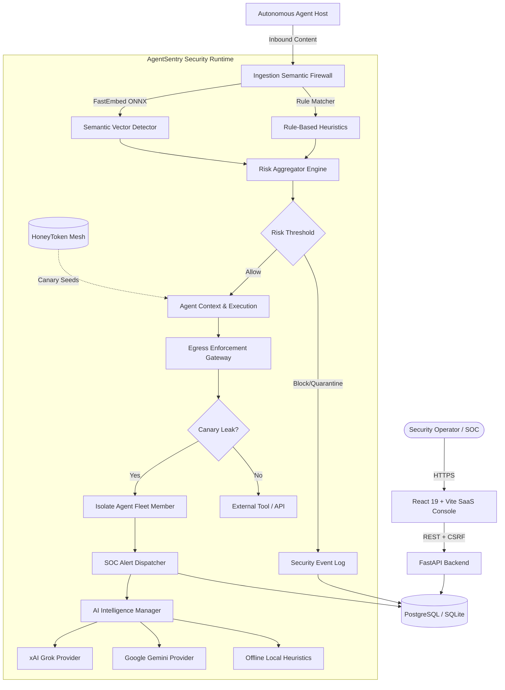

# AgentSentry

AgentSentry is an enterprise-grade cybersecurity runtime designed specifically to monitor, protect, and isolate autonomous AI Agents in production environments. It provides real-time defense against prompt injection, data exfiltration, adversarial directives, and decoy credential theft while maintaining an immutable audit trail of agent behavior.

---

## The Problem

As AI Agents gain tool execution privileges, access to enterprise databases, and integration into autonomous workflows, they become prime targets for attackers. Traditional network security firewalls cannot interpret unstructured LLM interactions or semantic intent. Attackers use indirect prompt injection, instruction overrides, and privilege escalation to manipulate agent execution, access proprietary context, and exfiltrate credentials via seemingly benign tool invocations.

---

## The Solution

AgentSentry envelopes autonomous agents within a defense-in-depth security perimeter:
1. **Ingestion Semantic Firewall**: Validates user inputs and external documents before they reach the agent using fast deterministic pattern filters and local vector embeddings (`bge-small-en-v1.5`).
2. **HoneyToken Canary Mesh**: Plants active decoy credentials within agent workspaces and prompts to detect exfiltration attempts.
3. **Egress Enforcement Gateway**: Intercepts outbound traffic and tool calls. If a decoy canary is detected in an outbound payload, execution is severed and the agent is immediately placed into cryptographically enforced isolation.
4. **AI Intelligence Engine (Grok, Gemini, Local)**: Offers real multi-provider threat classification, alert incident triage, and deep forensic explanations.
5. **Security Operations Center (SOC) Console**: A modern cybersecurity dashboard providing real-time telemetry, agent fleet controls, alert triage actions, and guided interactive attack simulations.

---

## Core Capabilities

- **Real AI Multi-Provider Subsystem**:
  - **xAI Grok**: Deep adversarial reasoning via `grok-beta` / `grok-2`.
  - **Google Gemini**: Rapid threat triage and multimodal evaluation via `gemini-1.5-flash`.
  - **Deterministic Local Heuristics**: 100% offline fallback requiring zero API keys, providing fast, deterministic threat classification.
- **Enterprise Authentication & Session Security**:
  - Secure HttpOnly JWT session cookies (`SameSite=Lax`, `Secure` in production).
  - Double-Submit Cookie CSRF defense on all state-mutating requests (`X-CSRF-Token` header).
  - Optional Google Single Sign-On mapping via Firebase OAuth tokens.
  - Multi-tenant tenant isolation ensuring operators can only manage agents within their boundary.
- **Canary Decoy Mesh (HoneyTokens)**:
  - Synthetic API keys, JWTs, and database connection strings bound to agent scopes.
  - Automatic rotation and canary lifecycle monitoring.
  - Zero token leakage: canary values are redacted across logs, API responses, and the UI.
- **Automated Fleet Isolation**:
  - Immediate quarantine and connection severing when canary triggers or critical thresholds are crossed.
  - Manual isolation and restoration controls with operator confirmation modals.
- **Incident Triage & Forensic Audit**:
  - Live AI Incident Triage offering risk assessment, recommended action, and containment playbooks.
  - AI Forensic Explanations detailing threat classifications, attacker intent, and identified IOCs.
  - Comprehensive health check telemetry endpoint (`GET /api/v1/system/status`).

---

## System Architecture



---

## Tech Stack

### Backend
- **Framework**: FastAPI (Python 3.12)
- **Database ORM**: SQLAlchemy 2.0 (asyncio) + Alembic
- **Database Engines**: PostgreSQL (`asyncpg`) in production, SQLite (`aiosqlite`) in development/tests
- **Embedding / Vector Engine**: FastEmbed (`BAAI/bge-small-en-v1.5` on ONNX runtime)
- **AI Integrations**: httpx async clients for xAI Grok API and Google Gemini REST API
- **Security & Crypto**: PyJWT, passlib (bcrypt), secrets, slowapi rate limiting

### Frontend
- **Framework**: React 19 + TypeScript
- **Tooling**: Vite 8, oxlint
- **UI Architecture**: Modern dark cybersecurity SaaS design system (inspired by 21st.dev)
- **Animations**: Framer Motion
- **Icons**: Lucide React
- **Interactive 3D**: Lazy-loaded `@splinetool/react-spline` on the landing page

---

## API Reference

### Health & Telemetry
- `GET /health` — Basic uptime check
- `GET /api/v1/system/status` — Comprehensive subsystem status (Database, AI Service, Semantic Firewall, Egress Gateway, and metrics)

### Authentication & User Management
- `POST /api/v1/auth/login` — Authenticate operator and issue HttpOnly cookies
- `POST /api/v1/auth/register` — Register a new operator analyst account
- `POST /api/v1/auth/firebase-login` — Authenticate via Firebase OAuth ID token
- `POST /api/v1/auth/logout` — Terminate session and clear security cookies
- `GET /api/v1/auth/me` — Retrieve active operator profile

### Monitoring & Operations
- `GET /api/v1/dashboard/stats` — Real-time telemetry summary metrics
- `GET /api/v1/agents` — List monitored autonomous agents
- `POST /api/v1/agents` — Register an agent
- `GET /api/v1/agents/{id}` — Get agent details and security posture
- `POST /api/v1/agents/{id}/isolate` — Lock down and isolate an agent
- `POST /api/v1/agents/{id}/restore` — Restore an isolated agent to active status
- `POST /api/v1/ingest` — Evaluate inbound prompt/document content through the firewall
- `POST /api/v1/agents/{id}/egress` — Validate outbound payload against honeytoken canary traps

### HoneyToken Decoy Mesh
- `GET /api/v1/honeytokens` — List configured canary decoy tokens
- `POST /api/v1/honeytokens` — Deploy a new honeytoken trap to an agent
- `POST /api/v1/honeytokens/rotate` — Revoke and rotate a decoy credential

### Alerts & Security Events
- `GET /api/v1/alerts` — Fetch dispatched incident alerts
- `PATCH /api/v1/alerts/{id}` — Update alert status (`acknowledged`, `resolved`, `ignored`)
- `POST /api/v1/alerts/{id}/triage` — Run AI Incident Triage on an alert
- `GET /api/v1/security-events` — Search and audit immutable security telemetry records
- `POST /api/v1/security-events/{id}/explain` — Generate an AI forensic explanation for an event

---

## Local Development Quickstart

### Prerequisites
- Python 3.11+
- Node.js 18+
- npm or pnpm

### 1. Installation
```bash
# Clone the repository
git clone https://github.com/dilipnetawat/AgentSentry.git
cd AgentSentry

# Install frontend dependencies
npm install --prefix frontend

# Set up Python virtual environment
python -m venv .venv
.\.venv\Scripts\activate      # Windows
# source .venv/bin/activate   # Linux/macOS

# Install backend dependencies
pip install -r backend/requirements.txt
```

### 2. Configuration
Copy the sample environment file:
```bash
cp .env.example .env
```
Key settings in `.env`:
- `ENVIRONMENT=development`
- `DATABASE_URL=sqlite+aiosqlite:///dev.db`
- `JWT_SECRET_KEY=dev-secret-do-not-use-in-production-change-in-prod-32chars`
- `AI_PROVIDER=auto` (set `XAI_API_KEY` or `GEMINI_API_KEY` if available; otherwise falls back automatically to the offline heuristic engine)

### 3. Application Routing Sequence

AgentSentry enforces a strict public-to-protected route boundary:

| Route | Access | Description |
| :--- | :--- | :--- |
| `/` | **Public** | Public Landing Page introducing the platform, core pillars, interactive architecture preview, and defense workflow. |
| `/login` | **Public** | Secure Operator Authentication & Registration with CSRF defense and cookie session management. Redirects to `/dashboard` upon login or if already authenticated. |
| `/dashboard` | **Protected** | SOC Command Center displaying real-time metrics, system health, and recent security events. |
| `/playground` | **Protected** | Secure AI Playground for executing prompt injection simulations, testing tool boundaries, and live provider evaluation. |
| `/agents` | **Protected** | Agent Fleet Management inventory and isolation/quarantine controls. |
| `/events` | **Protected** | Security Events log with risk scores, detector reasons, and payload inspection. |
| `/alerts` | **Protected** | Real-time Alert Queue with operator triage actions (Resolve, In-Progress, Dismiss). |
| `/honeytokens` | **Protected** | Canary HoneyToken tripwire generator and extraction tracking. |
| `/*` (unknown) | **Public** | Branded, calm 404 page with navigation back to Home or Console. |

### 4. Running with Docker Compose (Recommended)

AgentSentry runs fully containerized with PostgreSQL, FastAPI backend, and Nginx-proxied React frontend:

```bash
# Build and launch all services
docker compose up -d --build

# Access services:
# - Web Application & Landing Page: http://localhost:5173
# - FastAPI Documentation & Health: http://localhost:8000/docs
```

Default local credentials for Docker environment:
- **Operator Email**: `admin@agentsentry.local`
- **Password**: `adminpassword`

---

## Testing & Quality Assurance

Run the automated test suite across all subsystems:
```bash
# Run all 79 integration and unit tests
npm run test
# or: python -m pytest backend/tests/ -v

# Run frontend build check
npm run build

# Run linter
npm run lint
```

**Test Verification Summary**:
- `test_agents.py`: Agent registration, status updates, IDOR isolation boundaries (9 passed)
- `test_ai_and_features.py`: Grok, Gemini, Local AI provider triage, system telemetry, registration (10 passed)
- `test_alerts.py`: Firewall and honeytoken alert generation (2 passed)
- `test_dashboard_api.py`: Stats calculations, list pagination, telemetry aggregation (5 passed)
- `test_e2e_security_lifecycle.py`: End-to-end ingestion -> firewall -> alert -> isolation lifecycle (2 passed)
- `test_firewall.py`: Ingestion allow, block, quarantine decisions (4 passed)
- `test_fix_pass.py`: RBAC, secure cookie flags, CORS, pagination, idempotent seeding (8 passed)
- `test_honeytoken_mesh.py` & `test_honeytokens.py`: Canary lifecycle, rotation, trigger interception (8 passed)
- `test_ingestion.py`: Payload validation, length limits, isolation enforcement (5 passed)
- `test_risk_and_policy.py`: Multi-detector aggregation, score boundary caps (7 passed)
- `test_rule_detector.py`: Deterministic attack pattern filters across 14 adversarial vectors (14 passed)
- `test_semantic_detector.py` & `test_semantic_interface.py`: FastEmbed ONNX embedding calibration and cosine similarity (5 passed)

**Result**: `79 passed in 26.39s` (100% pass rate).

---

## Production Deployment

### Backend on Render
1. Create a **Web Service** pointing to this repository.
2. Root Directory: `.`
3. Build Command: `pip install -r backend/requirements.txt`
4. Start Command: `python -m alembic upgrade head && python -m uvicorn backend.main:app --host 0.0.0.0 --port $PORT`
5. Configure Environment Variables:
   - `ENVIRONMENT=production`
   - `DATABASE_URL=postgresql+asyncpg://<user>:<password>@<host>/<dbname>`
   - `JWT_SECRET_KEY=<32-char-random-string>`
   - `ALLOWED_ORIGINS=https://<your-vercel-app>.vercel.app`
   - `AI_PROVIDER=auto` (optionally set `XAI_API_KEY` or `GEMINI_API_KEY`)

### Frontend on Vercel
1. Import the repository into Vercel.
2. Root Directory: `frontend`
3. Framework Preset: `Vite`
4. Build Command: `npm run build`
5. Output Directory: `dist`
6. Environment Variables:
   - `VITE_API_BASE_URL=https://<your-render-backend>.onrender.com`

---
## Quickstart (Docker)

**Prerequisite:** Install and start [Docker Desktop](https://www.docker.com/products/docker-desktop/).

From the project folder, run:

```powershell
docker compose up -d --build
docker compose ps
```To stop the services:
docker compose down

## License

This project is licensed under the Apache 2.0 License.
