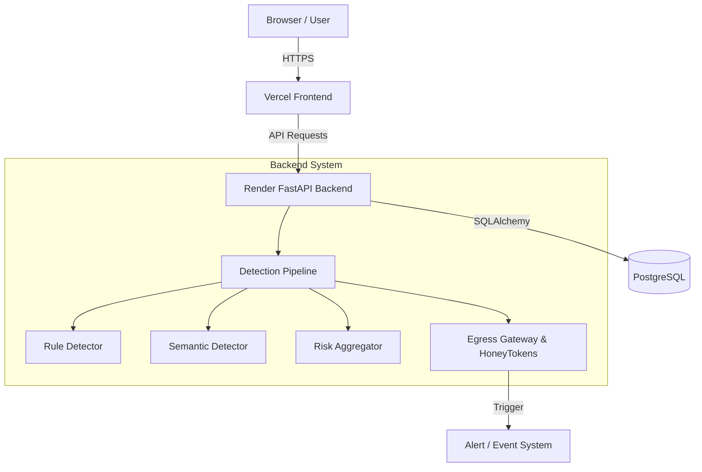

# AgentSentry

AgentSentry is a robust security platform designed specifically to monitor, protect, and isolate AI Agents in production environments. It provides real-time defense against prompt injection, data exfiltration, and unsafe tool execution while maintaining a full audit trail of agent behavior.

## Problem

As AI Agents gain autonomous execution capabilities and access to sensitive tools, they become prime targets for attackers. Traditional security models do not account for the unstructured nature of LLM interactions. Attackers can use prompt injection to manipulate agent behavior, access sensitive context, and exfiltrate data through seemingly benign tool calls.

## Solution

AgentSentry solves this by wrapping the AI Agent in a strict security perimeter. It acts as an Egress Enforcement Gateway and Ingestion Firewall, analyzing every input and output. By injecting active decoys (HoneyTokens) into the agent's context and utilizing semantic similarity models to detect attack intent, AgentSentry can instantly block malicious actions and automatically isolate compromised agents before damage occurs.

## Core Features

- **Authentication**: JWT-based session management using secure HttpOnly cookies.
- **RBAC**: Strict Role-Based Access Control (Admin, Analyst, Viewer).
- **Agent Ownership**: Enforced data isolation so users only interact with authorized agents.
- **Prompt-Injection Detection**: Validates inputs before they reach the agent.
- **Rule-Based Detection**: Fast, deterministic pattern matching for known malicious payloads.
- **Semantic Similarity**: Uses vector embeddings to detect semantic intent of unknown attacks.
- **Risk Aggregation**: Combines multiple detector signals into a unified risk score.
- **HoneyTokens**: Active decoys injected into the LLM context to detect unauthorized egress.
- **Egress Enforcement Gateway**: Intercepts and validates all outbound agent communications.
- **Automatic Isolation**: Quarantines agents the moment critical thresholds or HoneyTokens are triggered.
- **Security Events**: Immutable logging of all security decisions and context.
- **Alerts**: Real-time SOC dashboard notifications for analyst review.
- **Guided Demo**: Built-in interactive scenarios to demonstrate security capabilities.
- **Audit/Security Controls**: Comprehensive audit logging for all critical system actions.

## Architecture

AgentSentry follows a clean, layered architecture separating the presentation, API, and data layers:



## Detection Pipeline

All interactions pass through the Detection Pipeline:

Input → validation → rule-based detection → semantic similarity → risk aggregation → decision → event/alert → optional isolation

The semantic detection utilizes the `BAAI/bge-small-en-v1.5` model to compute cosine similarity against a database of attack-intent anchors. The pipeline evaluates the similarity/confidence and calculates a final risk score. High risk scores result in immediate rejection of the payload.

## HoneyToken Flow

AgentSentry injects tracked secrets into the prompt:

Agent context → active HoneyToken → malicious egress attempt → Egress Enforcement Gateway → BLOCK_AND_ISOLATE → security event → critical alert → agent isolation

The raw token values are strictly protected. They are redacted from the UI, browser-visible API responses, logs, event evidence, and source control.

## Authentication & Security

- **HttpOnly Cookies**: Prevents XSS token theft.
- **CSRF Protection**: Implements Double-Submit Cookie pattern for all mutating requests.
- **RBAC & Ownership**: Enforces strict boundaries on data access.
- **Rate Limiting**: Throttles authentication and API abuse.
- **CORS**: Strictly bound to the frontend origin (no wildcards allowed with credentials).
- **Security Headers**: Injects nosniff, frame-deny, and HSTS headers.
- **Request Size Limits**: Prevents payload-based DoS attacks.
- **Validation**: Strict Pydantic models for all inputs.
- **Secure Secret Handling**: Ensures development secrets are blocked in production.
- **Audit Logging**: Immutable tracking of critical user actions.

## Tech Stack

**Frontend**:
- React 19
- TypeScript
- Vite
- React Router
- Vanilla CSS
- Framer Motion
- Lucide React

**Backend**:
- FastAPI
- SQLAlchemy
- Alembic
- PostgreSQL (asyncpg) / SQLite (aiosqlite)
- Pydantic
- FastEmbed
- NumPy
- PyJWT
- passlib (bcrypt)
- slowapi

## Project Structure

```
AgentSentry/
├── backend/
│   ├── api/          # FastAPI routers and dependencies
│   ├── core/         # Security, config, and detectors
│   ├── models/       # SQLAlchemy models
│   ├── services/     # Business logic
│   └── main.py       # Application entrypoint
├── frontend/
│   ├── src/
│   │   ├── components/ # React components
│   │   ├── pages/      # Route pages
│   │   ├── services/   # API client
│   │   └── styles/     # Vanilla CSS
├── alembic/          # Database migrations
└── render.yaml       # Render deployment configuration
```

## Local Development

1. Clone the repository:
   ```bash
   git clone <repository-url>
   cd AgentSentry
   ```

2. Install frontend dependencies:
   ```bash
   cd frontend
   npm install
   cd ..
   ```

3. Create backend environment:
   ```bash
   python -m venv .venv
   source .venv/bin/activate  # On Windows: .\.venv\Scripts\activate
   ```

4. Install backend requirements:
   ```bash
   pip install -r backend/requirements.txt
   ```

5. Configure environment variables:
   ```bash
   cp .env.example .env
   # Edit .env with your local settings
   ```

6. Run migrations:
   ```bash
   alembic upgrade head
   ```

7. Start the application:
   ```bash
   # In one terminal (backend)
   uvicorn backend.main:app --reload

   # In another terminal (frontend)
   cd frontend
   npm run dev
   ```

## Environment Variables

Copy `.env.example` to `.env` to configure your environment. Do not commit `.env`.

**Backend Variables**:
- `ENVIRONMENT`: Set to `production` or `development`.
- `JWT_SECRET_KEY`: A strong, random 32+ character string.
- `ALLOWED_ORIGINS`: The URL of your frontend (e.g., `https://agentsentry.vercel.app`).
- `DATABASE_URL`: Connection string for PostgreSQL or SQLite.
- `ADMIN_EMAIL` / `ADMIN_PASSWORD`: Credentials for the initial admin account (development only).

**Frontend Variables**:
- `VITE_API_BASE_URL`: The URL of your deployed backend (e.g., `https://agentsentry-backend.onrender.com`).

## Deployment

### Backend — Render
1. Connect your GitHub repository to Render as a Web Service.
2. Set the root directory to `.` (the repository root).
3. Build Command: `pip install -r backend/requirements.txt`
4. Start Command: `alembic upgrade head && cd backend && uvicorn main:app --host 0.0.0.0 --port $PORT`
5. Configure Environment Variables:
   - `ENVIRONMENT=production`
   - `DATABASE_URL` (Use Render PostgreSQL URL, ensure it uses `postgresql://`)
   - `JWT_SECRET_KEY` (Generate a secure random string)
   - `ALLOWED_ORIGINS` (Set to your Vercel frontend URL)

### Frontend — Vercel
1. Import the GitHub repository into Vercel.
2. Framework Preset: Vite
3. Root Directory: `frontend`
4. Build Command: `npm run build`
5. Output Directory: `dist`
6. Environment Variables:
   - `VITE_API_BASE_URL`: The URL of your deployed Render backend.

## GitHub
This repository contains the full source code for the AgentSentry platform. All contributions must pass the security baseline before deployment.

## API

Key endpoints include:
- `GET /health` - System health check
- `POST /api/v1/auth/login` - Authenticate user
- `POST /api/v1/auth/logout` - Terminate session
- `GET /api/v1/auth/me` - Get current user profile
- `GET /api/v1/dashboard/stats` - Retrieve SOC metrics
- `GET /api/v1/agents` - List monitored agents
- `POST /api/v1/ingest` - Process incoming agent context
- `GET /api/v1/agents/{agent_id}/context` - Retrieve agent context (including HoneyTokens)
- `POST /api/v1/agents/{agent_id}/egress` - Validate outbound communications
- `GET /api/v1/honeytokens` - List active HoneyTokens
- `POST /api/v1/honeytokens/rotate` - Rotate a compromised HoneyToken
- `GET /api/v1/security-events` - Audit security events
- `GET /api/v1/alerts` - Monitor active alerts

## Security Model

When malicious input is detected during ingestion, the payload is immediately dropped with a 403 Forbidden response, generating a Security Event.
When a HoneyToken triggers during egress, the connection is instantly severed, the agent is moved to an ISOLATED state, and an urgent alert is dispatched to the SOC dashboard.

## Limitations / Known Constraints

- The Semantic Model (`bge-small-en-v1.5`) operates on CPU via FastEmbed, which may introduce latency under high concurrent load.
- Rate limiting relies on an in-memory sliding window, which requires external coordination (e.g., Redis) if scaled across multiple worker processes.
- The 3D UI scene relies on an external Spline dependency and will safely fallback to a standard component if network connectivity fails.

## Verification

Deployment verification checks:
- Backend Database Migrations: PASS
- Cross-Origin Cookie Handling: PASS
- Double-Submit CSRF Validation: PASS
- Agent Isolation Workflow: PASS
- Frontend Production Build: PASS

## Demo

The application includes a built-in Guided Demo on the dashboard. This interactive tool simulates benign ingestion, prompt injection attacks, and HoneyToken exfiltration, allowing evaluators to observe the SOC response in real-time.
